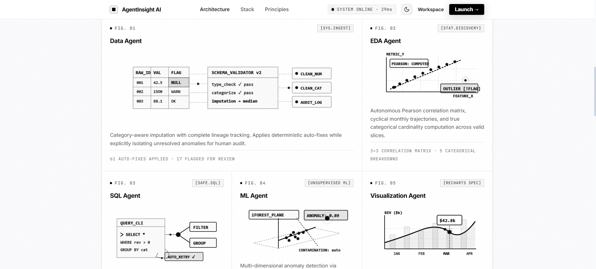
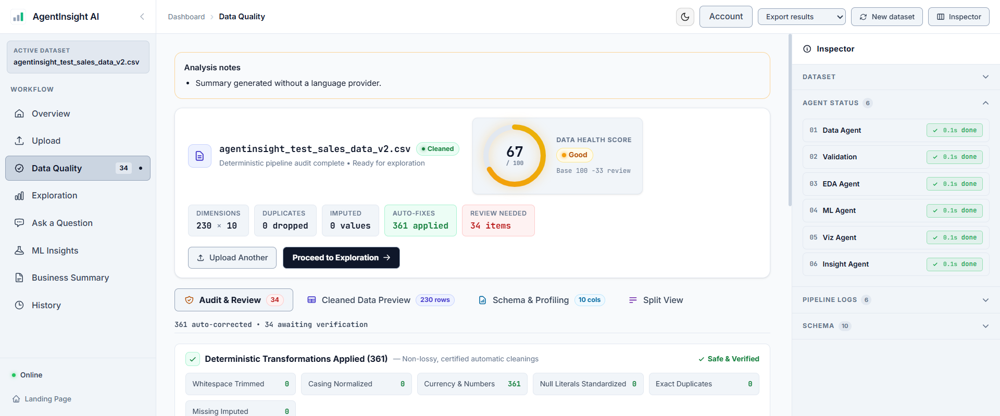
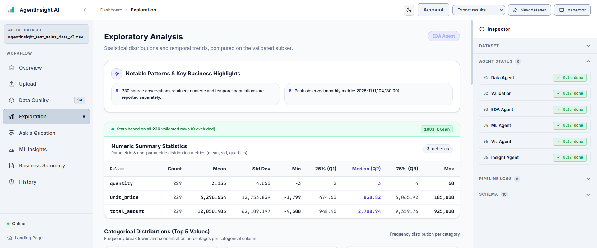
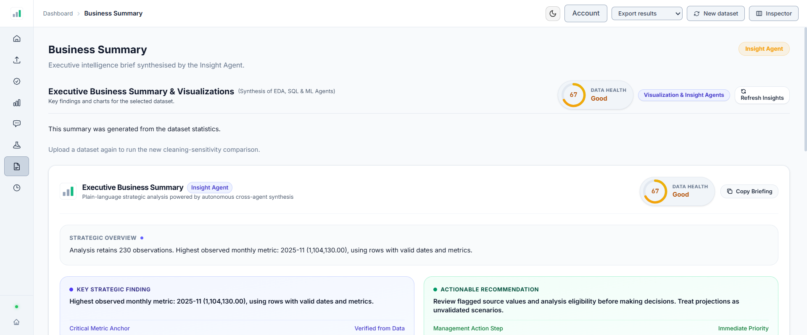
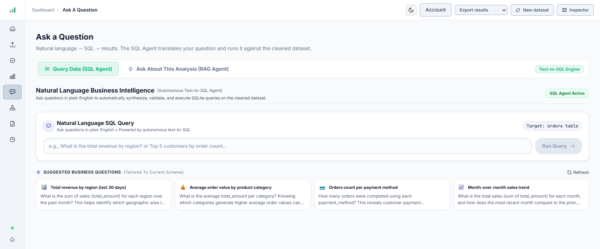

# AgentInsight AI - Autonomous Multi-Agent Business Intelligence Platform

AgentInsight AI is an autonomous, full-stack multi-agent platform designed to transform raw, noisy business datasets into clean, actionable intelligence. Orchestrated through specialized agents, the platform performs non-destructive data cleaning, statistical analysis, interactive visualization, executive recommendations, natural-language SQL queries, machine learning anomaly detection, predictive model building, and RAG-powered knowledge retrieval over analytical audits.

---

## Screenshots

### Landing Page


### Data Quality and Audit Trail


### Exploratory Data Analysis (EDA)


### Executive Business Summary and Charts


### Natural-Language SQL and RAG Assistant


---

## Architecture Overview

The platform uses a modular multi-agent architecture where each agent executes bounded responsibilities with strict validation and audit tracking guarantees:

```
                      +-----------------------------+
                      |   Raw File (.csv / .xlsx)   |
                      +--------------+--------------+
                                     |
                                     v
                      +-----------------------------+
                      |         Data Agent          |
                      | Cleaning, Parsing & Audit   |
                      +--------------+--------------+
                                     |
                                     v
                      +-----------------------------+
                      |      Validation Agent       |
                      | Business Rules & Isolation  |
                      +--------------+--------------+
                                     |
                +--------------------+--------------------+
                |                                         |
                v                                         v
+-------------------------------+         +-------------------------------+
|           EDA Agent           |         |           ML Agent            |
| Summary Stats, Corr, Trends   |         | Isolation Forest & Forecast   |
+---------------+---------------+         +---------------+---------------+
                |                                         |
                +--------------------+--------------------+
                                     |
                                     v
                      +-----------------------------+
                      |     Visualization Agent     |
                      | Smart Chart Configurations  |
                      +--------------+--------------+
                                     |
                                     v
                      +-----------------------------+
                      |        Insight Agent        |
                      | Executive Synthesis & Risks |
                      +--------------+--------------+
                                     |
                                     v
                      +-----------------------------+
                      |  SQL & Knowledge (RAG)      |
                      | SQLGlot Engine + TF-IDF RAG |
                      +--------------+--------------+
                                     |
                                     v
                      +-----------------------------+
                      | Persistent Storage (SQLite) |
                      | SQLAlchemy Datasets & Runs  |
                      +-----------------------------+
```

---

## Agent Specifications and Capabilities

### 1. Data Agent (Ingestion, Audit, and Normalization)
- Ingests raw CSV and Excel (`.xlsx`, `.xls`) files with UTF-8 BOM detection and blank-line preservation.
- Strips multi-currency symbols ($, EUR, GBP, JPY, INR), commas, and extraneous spacing while parsing numeric values.
- Identifier column protection: Retains string formats for IDs (e.g., `ORD-001`, `SKU-99`, postal codes) to prevent loss of precision or accidental conversion to NaN.
- Casing normalization on low-cardinality categorical attributes while protecting free-text columns.
- Explicit non-destructive imputation: Fills true missing values using median (numeric) or mode (categorical) only when requested, recording every modification with original line indices in the audit trail.

### 2. Validation Agent (Quality Assurance and Quarantine)
- Evaluates raw records against business logic: flags negative prices, impossible quantities, and calendar errors (e.g., February 30).
- Isolates problematic records into an `AuditReport` while supplying downstream analytical agents with uncontaminated validation subsets.
- Tracks source line numbers so users can map every identified issue back to original input spreadsheets.

### 3. EDA Agent (Exploratory Data Analysis)
- Descriptive statistics across all numeric attributes (mean, median, standard deviation, quartiles, min/max).
- Categorical frequency distributions with percentage breakdowns.
- Pearson correlation matrix across numeric features.
- Monthly temporal aggregation for revenue and volume trends across calendar intervals.

### 4. ML Agent (Anomaly Detection and Trend Forecasting)
- Per-category normalized Isolation Forest: Evaluates statistical deviations within category peers rather than global distributions, avoiding false alarms on high-value categories.
- Plain-text explanations for flagged anomalies with percentage variance metrics.
- Linear regression modeling across historical periods with dynamic confidence levels (`high`, `medium`, `insufficient`).

### 5. Model Builder (Workspace Training and Colab Export)
- Workspace Model Training: In-browser model configuration for classification and regression tasks on tabular datasets with train/test splits and evaluation metrics.
- Colab Export Bundle: Generates a self-contained ZIP file containing an automated Jupyter notebook and extracted training CSV for execution in Google Colab.

### 6. Visualization Agent (Chart Synthesis)
- Automatically recommends visual representations based on data shapes (distribution bars, trend lines, correlation heatmaps).
- Emits declarative chart specifications rendered natively through responsive SVG components.

### 7. Insight Agent (Executive Synthesis)
- Aggregates findings from EDA, ML anomalies, and data validation into an Executive Summary.
- Delivers prioritized recommendations, operational risks, and growth opportunities.

### 8. SQL Agent (Text-to-SQL Execution)
- Converts natural-language queries into read-only SQLite `SELECT` statements executed against in-memory validated tables.
- Security-first parsing: Validates AST via SQLGlot to strictly prohibit mutating statements (`INSERT`, `UPDATE`, `DELETE`, `DROP`, `ALTER`, `TRUNCATE`, `ATTACH`).
- Self-correction retry logic on syntax errors with deterministic fallbacks for standard schema queries.

### 9. Knowledge Agent (TF-IDF RAG Retrieval)
- Indexes data quality audit logs and analytical summaries into a structured knowledge base.
- Uses scikit-learn TF-IDF vectorization and cosine similarity with row-number boosting.
- Dual retrieval modes: Query within the current active dataset or across historical uploads.
- Evidence drawer provides similarity scores, chunk types, and line citations.

### 10. Job Supervisor and Async Queue
- SQLite-backed asynchronous task queue (`/api/jobs`) with supervisor thread pool.
- Handles heavy file processing without blocking the HTTP event loop.
- Supports frontend heartbeat polling with status endpoints and failure recovery.

---

## Tech Stack

| Layer | Technology | Purpose |
|---|---|---|
| Workflow Orchestration | LangGraph | State machine and multi-agent coordination |
| Backend Framework | FastAPI + Uvicorn | Asynchronous REST API and WebSocket/SSE support |
| Data Processing | pandas, NumPy | High-performance tabular transformation and audit tracking |
| Machine Learning & RAG | scikit-learn | Isolation Forest, Linear Regression, TF-IDF, Cosine Similarity |
| SQL Engine & Validation | SQLGlot, SQLite | AST safety verification and read-only query execution |
| Database & ORM | SQLAlchemy | Multi-tenant schema, dataset snapshots, and audit tables |
| LLM Integration | Groq API | Low-latency inference for Text-to-SQL and business Q&A |
| Frontend Framework | React 19 + TypeScript + Vite | Type-safe single-page reactive dashboard |
| Styling & Theming | Tailwind CSS + CSS Tokens | Responsive layout with persistent Dark and Light mode |

---

## Project Directory Structure

```
insight/
|-- backend/
|   |-- agents/
|   |   |-- data_agent.py           # Ingestion, parsing, and data quality auditing
|   |   |-- eda_agent.py            # Descriptive statistics and correlation analysis
|   |   |-- insight_agent.py        # Executive summary and recommendation engine
|   |   |-- knowledge_agent.py      # TF-IDF RAG over audit logs and summaries
|   |   |-- ml_agent.py             # Isolation Forest anomaly detection and forecasting
|   |   |-- sql_agent.py            # Natural language to SQLite query execution
|   |   |-- validation.py           # Business rule checks and quarantined subsets
|   |   `-- visualization_agent.py  # Declarative chart configuration generator
|   |-- db/
|   |   |-- database.py             # Database engine setup and session factory
|   |   `-- models.py               # SQLAlchemy ORM models (Jobs, Datasets, Audits)
|   |-- orchestrator/
|   |   |-- graph.py                # LangGraph pipeline definition
|   |   `-- state.py                # Pipeline state definitions
|   |-- tests/                      # Pytest unit and regression test suite
|   |-- auth.py                     # Session-based authentication and user workspaces
|   |-- config.py                   # Environment configuration and validation thresholds
|   |-- contracts.py                # Pydantic schemas and serialization models
|   |-- jobs.py                     # Job queue manager and worker process pool
|   |-- main.py                     # FastAPI application routes and lifecycle
|   |-- model_builder.py            # Model training and algorithmic recommendation
|   |-- model_export.py             # Colab export bundle packaging
|   |-- providers.py                # LLM client abstractions
|   |-- repository.py               # Dataset persistence and snapshot management
|   |-- requirements.txt            # Python dependencies
|   `-- run.bat                     # Windows backend execution script
|
|-- frontend/
|   |-- src/
|   |   |-- components/
|   |   |   |-- dashboard/          # Layout, header, canvas, and workspace navigation
|   |   |   |-- eda/                # Statistics tables, trends, and correlation views
|   |   |   |-- history/            # Historical snapshot viewer and restore
|   |   |   |-- insights/           # Executive summaries and risk breakdown
|   |   |   |-- landing/            # Landing page and platform presentation
|   |   |   |-- ml/                 # Anomaly cards, regressions, and Model Builder
|   |   |   |-- sql/                # SQL query editor and RAG knowledge assistant
|   |   |   `-- upload/             # File dropzone and stage progress tracker
|   |   |-- context/                # ThemeContext for Light and Dark modes
|   |   |-- types/                  # TypeScript interface definitions
|   |   |-- api.ts                  # Centralized HTTP client wrapper
|   |   |-- auth.ts                 # Client-side authentication utilities
|   |   |-- App.tsx                 # Root application component and view router
|   |   `-- main.tsx                # React 19 entry point
|   |-- package.json
|   `-- vite.config.ts
|
|-- dev.bat                         # Unified startup script for frontend and backend
|-- run_backend.bat                 # Root helper script to launch backend
|-- setup_backend.bat               # Environment initialization script
`-- README.md
```

---

## Getting Started

### Prerequisites
- Python 3.11 or higher
- Node.js 18 or higher (with npm)
- Groq API Key (Optional for basic deterministic tasks; required for full natural-language SQL and open-ended Q&A)

---

### Step 1: Clone the Repository
```bash
git clone https://github.com/umesh-dev31/MultiAgentBI.git
cd MultiAgentBI
```

---

### Step 2: Backend Setup

1. Create and activate a Python virtual environment:
   ```bash
   # Windows (PowerShell)
   python -m venv .venv
   .\.venv\Scripts\Activate.ps1

   # macOS / Linux
   python3 -m venv .venv
   source .venv/bin/activate
   ```

2. Install dependencies:
   ```bash
   pip install -r backend/requirements.txt
   ```

3. Configure environment variables:
   ```bash
   # Windows
   copy backend\.env.example backend\.env

   # macOS / Linux
   cp backend/.env.example backend/.env
   ```

4. Add your API key to `backend/.env`:
   ```env
   GROQ_API_KEY=your_groq_api_key_here
   GROQ_MODEL=openai/gpt-oss-120b
   ```

---

### Step 3: Frontend Setup

```bash
cd frontend
npm install
cd ..
```

---

### Step 4: Run the Application

#### Option A: Unified Windows Launcher
From the project root, run:
```bat
dev.bat
```
This script launches both the FastAPI backend (port 8000) and the Vite frontend (port 5173).

#### Option B: Individual Terminals

Terminal 1 (Backend):
```bash
cd backend
.\run.bat
# or directly:
# uvicorn main:app --reload --host 127.0.0.1 --port 8000
```

Terminal 2 (Frontend):
```bash
cd frontend
npm run dev
```

Open `http://localhost:5173` in your browser.

---

## API Reference

### Authentication and Session Management
- `POST /api/auth/register` - Create a new user account and associated personal workspace.
- `POST /api/auth/login` - Authenticate user credentials and establish a secure HTTP-only session.
- `GET /api/auth/session` - Return the current signed-in user and workspace metadata.
- `POST /api/auth/logout` - Revoke the active session.

### Asynchronous Job Processing
- `POST /api/jobs` - Submit a dataset file for processing; returns `202 Accepted` with a `job_id`.
- `GET /api/jobs/{job_id}` - Poll processing progress, stage status, and execution logs.

### Analysis and Querying
- `POST /api/datasets/{dataset_id}/analysis/{kind}` - Trigger on-demand analysis (`eda`, `ml-insights`, `insights`).
- `POST /api/query` - Execute natural-language questions translated to read-only SQLite SQL.
- `POST /api/knowledge/ask` - Submit questions to the RAG Knowledge Agent with source citations.
- `GET /api/knowledge/suggested-questions` - Retrieve schema-grounded business questions.

### Machine Learning and Model Builder
- `POST /api/datasets/{dataset_id}/model/inspect` - Evaluate feature eligibility and recommend models.
- `POST /api/datasets/{dataset_id}/model/train` - Submit an in-workspace model training job.
- `POST /api/datasets/{dataset_id}/model/export` - Download a runnable Google Colab ZIP package.

### History and Exports
- `GET /api/history` - List all historical dataset runs in the workspace.
- `GET /api/history/{dataset_id}` - Restore an analytical run snapshot into the workspace.
- `GET /api/export/{dataset_id}?format=csv|json|html` - Export sanitized data, analysis JSON, or printable HTML reports.

---

## Testing and Quality Verification

### Run Backend Tests
```bash
# Execute pytest with temp directory allocation
pytest backend/tests/ --basetemp=./tmp
```

### Run Frontend Production Build
```bash
cd frontend
npm run build
```

---

## Security and Reliability

- AST SQL Validation: SQL queries generated by the LLM undergo Abstract Syntax Tree validation via SQLGlot before execution. Any non-SELECT syntax is rejected immediately.
- Non-Destructive Data Preservation: Raw records are preserved without silent dropping. Issues are logged with original line numbers for full transparency.
- Session Isolation: Each account receives isolated workspace storage to prevent cross-tenant data access.
- Local Storage Decoupling: Uses SQLAlchemy ORM to allow seamless migration between local SQLite and production PostgreSQL.

---

## License

This project is licensed under the MIT License. See the LICENSE file for details.
